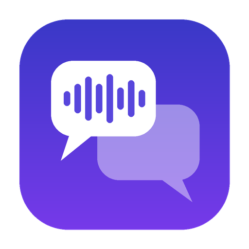
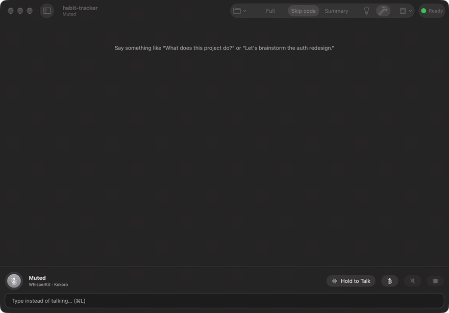
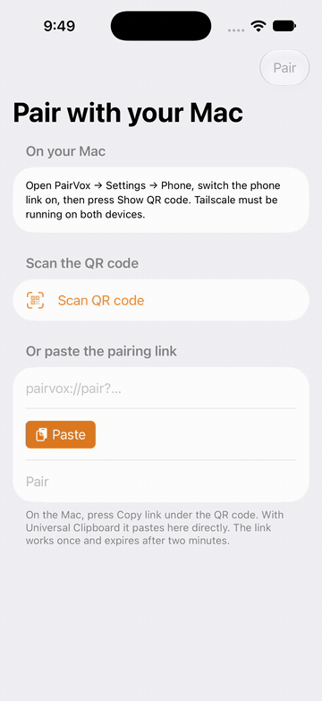
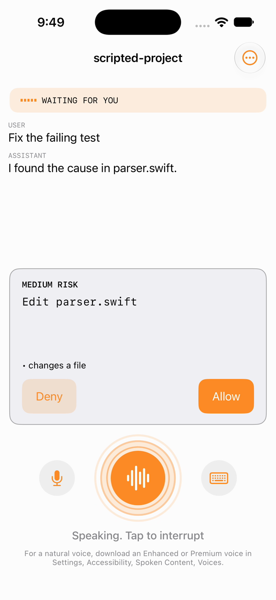
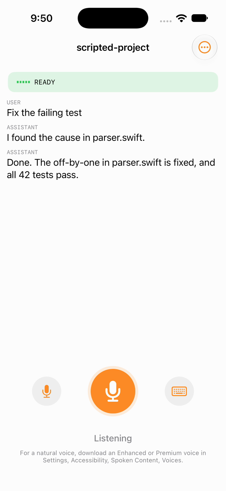

<p align="center"></p>

<h1 align="center">PairVox</h1>

<p align="center"><b>Talk to Claude Code like a pair-programming partner.</b><br>
A native macOS voice front-end: speak, interrupt it mid-sentence, brainstorm, and approve changes hands-free.</p>

<p align="center">Works with Claude Code · Apache-2.0 · On-device speech · No telemetry</p>

---

PairVox puts a live voice loop in front of the [Claude Code](https://code.claude.com) CLI on your Mac, similar to ChatGPT Advanced Voice or Gemini Live:

- **Just talk.** Hands-free listening with voice-activity detection, or hold **⌃⌥Space** to talk.
- **Interrupt any time (barge-in).** Start speaking and PairVox stops talking immediately. Say something new while Claude is working and PairVox interrupts the turn and redirects it.
- **Hear replies as they stream.** The first sentence starts playing while Claude is still writing the rest.
- **Choose how much you hear.**
  - *Full*: everything is read, including code, line by line.
  - *Skip code*: prose is read; code is described briefly ("a 12-line Swift snippet").
  - *Summary*: only the opening summary is read. Say "details" for the rest.
- **Brainstorm or execute.** *Brainstorm* runs Claude Code in plan mode, so it discusses and plans but changes nothing. *Execute* lets it work.
- **Approve by voice, safely.** "Yes", "no", "always allow", or "no, edit the other file instead". Destructive actions (deleting files, pushing, `sudo`, edits outside the project) need a click by default. If you choose, you can allow them by voice too, with a deliberate phrase (Settings → General → Permissions); that switch is off until you turn it on.
- **Natural, local voices.** Speech recognition uses [WhisperKit](https://github.com/argmaxinc/WhisperKit), with Apple Speech as the fallback. The voice is [Kokoro-82M](https://huggingface.co/hexgrad/Kokoro-82M), falling back to the macOS system voice. Speech never leaves your Mac.

## See it work

<table>
<tr>
<td width="62%" valign="top"></td>
<td width="38%" valign="top"></td>
</tr>
<tr>
<td valign="top"><b>Mac.</b> Ask for a change, hear the reply as it streams, and answer the request card by voice or with a click.</td>
<td valign="top"><b>iPhone.</b> Pair once, follow the Mac's session, and approve with Face ID. The Mac decides what a yes may approve.</td>
</tr>
</table>

<p>



</p>

The iPhone recordings use `pairvox-link-testhost`, the stand-in Mac host in this repository, so the conversation on the phone is scripted.

## Download

Get the Mac app and the iPhone app from [Releases](https://github.com/arcwel/PairVox/releases). Each release lists SHA-256 checksums and carries its security reports.

**Mac (`PairVox-<version>.dmg`).** Drag PairVox to Applications. This build is not notarized yet (that needs a paid Apple Developer account), so macOS blocks the first launch:

1. Open PairVox once and close the warning.
2. Open System Settings, Privacy & Security, scroll to "PairVox was blocked", and click **Open Anyway**.
3. Open PairVox again and confirm.

**iPhone (`PairVoxPhone-<version>-unsigned.ipa`).** There is no App Store or TestFlight build yet, for the same reason. Two ways in:

- Sideload the `.ipa` with [AltStore](https://altstore.io) or [Sideloadly](https://sideloadly.io). They sign it with your own Apple ID. With a free Apple ID the app opens for 7 days, then needs reinstalling.
- Build it from source with Xcode and your own Apple ID: see [ios/README.md](ios/README.md). The same 7-day limit applies to a free Apple ID.

The phone also needs [Tailscale](https://tailscale.com) on both devices: see [docs/PHONE_LINK_SETUP.md](docs/PHONE_LINK_SETUP.md).

> PairVox is an independent open-source project. It works with Claude Code but is not affiliated with or endorsed by Anthropic. “Claude” and “Claude Code” are trademarks of Anthropic.

## How it signs in (and why it's built this way)

PairVox **never** asks for, reads, or stores your Claude credentials. It launches **your own, unmodified `claude` CLI** as a subprocess in headless `stream-json` mode, and the CLI uses whatever login you set up in Anthropic's own sign-in flow. Two modes:

| | Claude subscription (default) | Anthropic API key |
|---|---|---|
| How | Your `claude` CLI's existing login (`claude` → `/login`) | Your own Console key, stored in the macOS Keychain and passed only to the CLI process |
| Billing | Your plan's usage limits | Your Console account, per token |

Anthropic's [legal and compliance page](https://code.claude.com/docs/en/legal-and-compliance) says third-party apps may not offer Claude.ai login or route requests through other people's subscription credentials. Signing in to the unmodified Claude Code binary with your own subscription is explicitly allowed. PairVox is designed to stay on that side of the line: it has no login UI, never touches tokens, and is free, local software for your own use. If you build a commercial or hosted product on top of it, use API keys and read Anthropic's Commercial Terms first.

## Requirements

- macOS 15 (Sequoia) or later on Apple Silicon. Kokoro runs on MLX; on Intel Macs the system voice is used.
- [Claude Code](https://code.claude.com/docs/en/setup), installed and signed in (`claude`, then `/login`).
- Xcode 26 or later to build from source, plus [XcodeGen](https://github.com/yonaskolb/XcodeGen) (`brew install xcodegen`).

## Build and run

```bash
git clone https://github.com/arcwel/PairVox.git && cd PairVox
make test        # engine unit tests (uses --build-system native on macOS; also runs on Linux)
make app         # builds dist/PairVox.app (ad-hoc signed)
open dist/PairVox.app
```

To work in Xcode instead, run `make xcode` and use the **PairVox** scheme. Build through Xcode or `make app`, not plain `swift build`, if you want the Kokoro voice: only Xcode compiles MLX's Metal shaders. Without them PairVox falls back to the system voice automatically.

On first launch PairVox:
1. finds your `claude` CLI and checks its version;
2. asks for microphone (and, as a fallback, speech-recognition) permission;
3. downloads WhisperKit's model (~500 MB, cached) and the Kokoro voice (~340 MB, SHA-256 verified). You can talk right away: Apple Speech and the system voice cover the gap.

Open a project folder and start talking.

## Terminal mode (`pairvox-cli`)

The same engine, with a terminal front-end. Handy for testing and for measuring latency (macOS or Linux):

```bash
swift run pairvox-cli --cwd ~/code/myapp --say --metrics
```

Type what you would say. Typing while it talks interrupts it, just like speaking would. Pass `--api-key-env ANTHROPIC_API_KEY` to use a key instead of your Claude login, and `--help` for all options.

## Voice commands

Short phrases are handled locally; everything else goes to Claude.

| Say | Does |
|---|---|
| “stop”, “wait”, “hold on” | Stop talking (Claude keeps working) |
| “cancel”, “never mind”, “stop that” | Interrupt Claude's current turn |
| *anything else while Claude works* | Interrupt and redirect with your new instruction |
| “repeat that” | Replay the last reply |
| “details”, “tell me more” | Read what summary mode held back |
| “read the code” | Read the last reply's code aloud |
| “skip” | Skip the current sentence |
| “summary mode” / “skip code” / “full mode” | Change how much is read |
| “brainstorm mode” / “execute mode” | Plan-only vs. making changes |
| “yes” / “no” / “always allow” | Answer a permission prompt |
| “no, *do this instead*” | Deny, and tell Claude what to do instead |
| “faster” / “slower” | Speech rate |
| “new session” | Start a fresh Claude Code session |

## Privacy

- Audio is captured, transcribed and synthesized **on your Mac**.
- PairVox has **no telemetry** and makes no network requests of its own, except one-time model downloads from GitHub/Hugging Face mirrors, which are verified by hash.
- Your words go to Anthropic only through your own Claude Code CLI, exactly as if you had typed them.
- See [docs/THREAT_MODEL.md](docs/THREAT_MODEL.md) for the security design, including why spoken approvals are restricted.

## Project layout

```
Sources/PairVoxCore    Engine: Claude Code protocol, sessions, speech pipeline, policy (macOS + Linux)
Sources/PairVoxCLI     pairvox-cli terminal front-end
Sources/PairVoxVoice   macOS audio: echo-cancelled I/O, WhisperKit/Apple STT, Kokoro/system TTS
Sources/PairVoxApp     SwiftUI app
Tests/                 Unit tests, including a replay of a real Claude Code session
docs/                  Architecture, protocol notes, threat model, roadmap
```

See [docs/ARCHITECTURE.md](docs/ARCHITECTURE.md) for how it fits together.

## Roadmap

The macOS app is v1, with several projects at once, folder-level approvals, plain-language request summaries and a mini or menu-bar mode. An **iPhone client** is under way: the Mac hosts the session over Tailscale and the phone handles voice (`ios/`, first build; see [ios/README.md](ios/README.md)). Cross-project approvals, answering another project's request without switching, are specified in [docs/prd/cross-project-approvals-prd.md](docs/prd/cross-project-approvals-prd.md). See [docs/ROADMAP.md](docs/ROADMAP.md) for status and [docs/security/](docs/security/) for the audits.

## Contributing

Issues and PRs welcome — see [CONTRIBUTING.md](CONTRIBUTING.md). Security reports: [SECURITY.md](SECURITY.md).

## License

Apache License 2.0 — see [LICENSE](LICENSE) and [NOTICE](NOTICE). Third-party components and model files are listed in [THIRD_PARTY_LICENSES.md](THIRD_PARTY_LICENSES.md).

## Phone link

The phone talks to the Mac over Tailscale. **If your tailnet uses access rules, allow your phone to reach your Mac on TCP port 47821, or pairing fails silently.** Full setup, the exact rule and troubleshooting: [docs/PHONE_LINK_SETUP.md](docs/PHONE_LINK_SETUP.md).

### From the terminal

`pairvox-link` talks to the running app (private socket in `~/Library/Application Support/PairVox/`). Every command has `--json`; exit codes are 0 done, 1 refused, 2 bad usage, 3 PairVox not running.

```bash
swift run pairvox-link status
swift run pairvox-link pair               # prints a QR code and the same pairing link as text
swift run pairvox-link phones list
swift run pairvox-link phones remove <id> --dry-run
swift run pairvox-link phones prune --stale --days 30 --dry-run   # phones not seen for 30 days; connected ones are never listed
```

A new phone still needs your click on the Mac ("Pair"). Removing a phone disconnects it at once and destroys its key.
